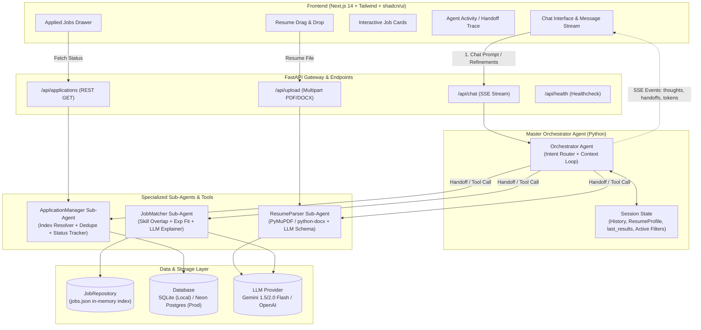
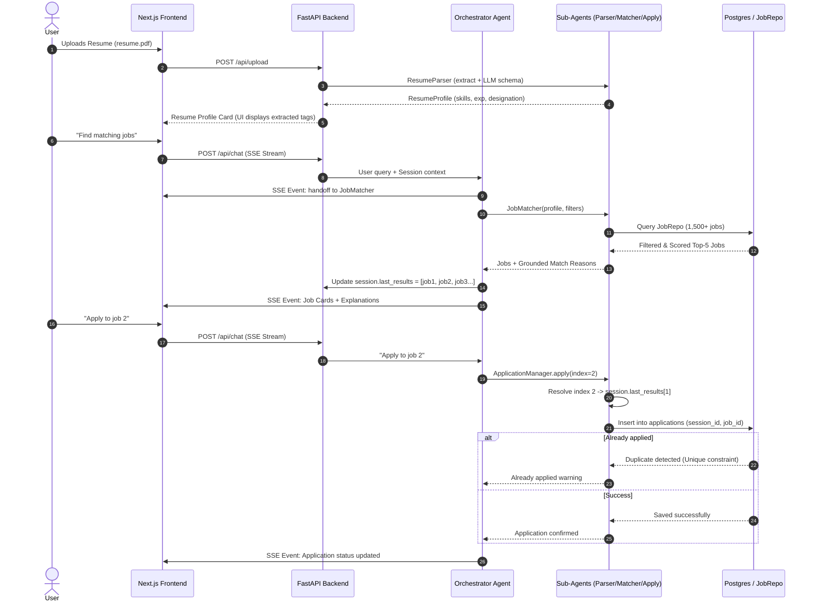

# System Design Document: AI Job Chat Assistant

> **Company:** Hidani Tech  
> **Role Assessment:** SDE Intern - AI Agents & Automation  
> **Author:** Candidate  

---

## 1. System Architecture Overview

The system uses a **Decoupled Client-Server Architecture** featuring a **Multi-Agent Orchestrator** on the backend and an interactive, conversational frontend with real-time **Server-Sent Events (SSE)**.



---

## 2. Core Components & Sub-Agent Design

### 2.1 Master Orchestrator Agent
- **Role:** Central brain managing conversational context, deciding which sub-agent/tool to trigger, and streaming progress back to the user.
- **Why Custom Loop (No LangChain):** Complete visibility into tool-calling, lower latency, zero framework overhead, and easily defendable during the technical interview.
- **Workflow:**
  1. Receives user message + `session_id`.
  2. Inspects conversational memory and current state (has resume? what are `last_results`?).
  3. Formulates a tool call or direct response.
  4. Emits real-time SSE events (`agent_handoff`, `agent_thought`, `job_results`, `token`).

### 2.2 Sub-Agent 1: ResumeParser Agent
- **Role:** Ingests binary PDF/DOCX, extracts text, and maps into a clean Pydantic schema:
  - `name`, `contact` (email, phone, linkedin), `designation`, `skills` (list of standardized tokens), `years_of_experience`, `education`, `projects`.
- **Error Handling:** Detects empty text (scanned PDF), corrupted headers, or non-resume documents, prompting user to upload a valid text PDF/DOCX.

### 2.3 Sub-Agent 2: JobMatcher Agent
- **Role:** Finds the best matching jobs from `jobs.json` (over 2,900 verified listings) and explains why.
- **Hybrid Matching Engine:**
  - **Deterministic Scoring (Code):**
    $$\text{Score} = w_1 \times \text{SkillOverlap} + w_2 \times \text{ExperienceFit} + w_3 \times \text{DesignationSimilarity}$$
    - Synonyms supported: `JS` ↔ `JavaScript`, `TS` ↔ `TypeScript`, `FastAPI` ↔ `Python`, `Next.js` ↔ `React`.
  - **Grounded Reason Generation (LLM):** LLM receives only the matched skills and job title to produce a 1–2 sentence bulleted highlight. Hallucination is mathematically prevented.
- **Conversational Refinement:**
  - Understands *"only remote"*, *"require React"*, *"located in Bangalore"*.
  - Stacks filters statefully in the session.

### 2.4 Sub-Agent 3: ApplicationManager Agent
- **Role:** Handles applying to jobs and tracking application statuses.
- **Index-to-ID Resolver:**
  - When user says *"apply to job 3"*, the agent looks up `session.last_results[2]` to find the real `job_id`.
  - Also accepts direct IDs (e.g., *"apply to job #1402"*).
- **Deduplication:**
  - Checks database before insertion. If already applied, returns: *"You already applied to [Job Title] on [Date]. Status: Applied"*.
- **Tracking:**
  - Queries all applications for current `session_id` and formats into cards or tables.

---

## 3. Dataflow & Sequence Diagram



---

## 4. Database Schema (SQLAlchemy / PostgreSQL & SQLite)

```sql
-- Applications table (Track applied jobs per anonymous session)
CREATE TABLE applications (
    id VARCHAR(36) PRIMARY KEY,
    session_id VARCHAR(64) NOT NULL,
    job_id VARCHAR(64) NOT NULL,
    job_title VARCHAR(255) NOT NULL,
    company VARCHAR(255) NOT NULL,
    applied_at TIMESTAMP WITH TIME ZONE DEFAULT CURRENT_TIMESTAMP,
    status VARCHAR(50) DEFAULT 'APPLIED',
    notes TEXT,
    CONSTRAINT uq_session_job UNIQUE (session_id, job_id)
);

CREATE INDEX idx_applications_session ON applications(session_id);
```

---

## 5. Complete File & Folder Structure

```
hidani-assessment/
│
├── data/                                  # Datasets & Taxonomies
│   ├── jobs.json                          # 1,500 - 2,000 real job records (Core Deliverable)
│   └── skills_taxonomy.json               # Tech skills dictionary with synonyms
│
├── scraper/                               # Independent Job Scraper Pipeline (Deliverable)
│   ├── __init__.py
│   ├── run_scraper.py                     # CLI entrypoint to crawl and generate data/jobs.json
│   ├── base_source.py                     # Abstract Base Scraper class (retry, rate limit)
│   ├── arbeitnow_source.py                # Source 1: Arbeitnow API
│   ├── remotive_source.py                 # Source 2: Remotive API
│   ├── greenhouse_source.py               # Source 3: Greenhouse public boards
│   ├── skill_extractor.py                 # Skill & Experience taxonomy extractor
│   └── test_scraper.py                    # Scraper smoke test
│
├── backend/                               # Python FastAPI Backend
│   ├── app/
│   │   ├── __init__.py
│   │   ├── main.py                        # FastAPI entry, CORS, lifespan (loads jobs.json)
│   │   ├── config.py                      # Settings (.env variables, API keys, DB URL)
│   │   │
│   │   ├── api/                           # API Routes & Streaming
│   │   │   ├── __init__.py
│   │   │   ├── endpoints.py               # /upload, /chat (SSE), /applications, /health
│   │   │   └── dependencies.py            # DB session and session store injections
│   │   │
│   │   ├── core/                          # Infrastructure & Session State
│   │   │   ├── __init__.py
│   │   │   ├── db.py                      # SQLAlchemy engine, sessionmaker, Base
│   │   │   ├── events.py                  # SSE streaming helpers (handoff, thoughts, tokens)
│   │   │   └── session.py                 # In-memory session store (last_results, filters)
│   │   │
│   │   ├── models/                        # Schemas & DB Models
│   │   │   ├── __init__.py
│   │   │   ├── db_models.py               # SQLAlchemy Application model
│   │   │   └── schemas.py                 # Pydantic schemas (ResumeProfile, Job, ChatRequest)
│   │   │
│   │   ├── repositories/                  # Data Access Layer
│   │   │   ├── __init__.py
│   │   │   ├── job_repo.py                # In-memory JobRepository (fast search & filter)
│   │   │   └── app_repo.py                # Application DB CRUD with duplicate handling
│   │   │
│   │   ├── llm/                           # LLM Layer (Provider-Agnostic)
│   │   │   ├── __init__.py
│   │   │   ├── client.py                  # Gemini / OpenAI client wrapper
│   │   │   └── prompts.py                 # System prompts for orchestrator & sub-agents
│   │   │
│   │   └── agents/                        # Multi-Agent Architecture
│   │       ├── __init__.py
│   │       ├── orchestrator.py            # Master agent tool-calling loop & router
│   │       ├── parser_agent.py            # Sub-agent: PDF/DOCX to structured ResumeProfile
│   │       ├── matcher_agent.py           # Sub-agent: deterministic scoring + match reason
│   │       └── apply_agent.py             # Sub-agent: index resolver & application tracker
│   │
│   ├── tests/                             # Unit & Integration Tests
│   │   ├── test_parser.py                 # Valid/invalid/corrupt resume tests
│   │   ├── test_matcher.py                # Skill overlap, filter stacking, top-k tests
│   │   └── test_apply.py                  # Dedupe and index resolution tests
│   │
│   ├── requirements.txt                   # FastAPI, uvicorn, PyMuPDF, python-docx, etc.
│   ├── Dockerfile                         # Backend containerization for deployment
│   └── .env.example                       # Documented environment variables
│
├── frontend/                              # Next.js 14 (App Router) + TypeScript
│   ├── src/
│   │   ├── app/
│   │   │   ├── layout.tsx                 # Root layout with theme provider
│   │   │   ├── page.tsx                   # Main chat and dashboard page
│   │   │   └── globals.css                # Tailwind styling
│   │   │
│   │   ├── components/                    # React UI Components
│   │   │   ├── chat/
│   │   │   │   ├── ChatContainer.tsx      # Main conversational window
│   │   │   │   ├── MessageList.tsx        # Chat bubbles with Markdown rendering
│   │   │   │   ├── ChatInput.tsx          # Message input + file upload trigger
│   │   │   │   └── AgentTraceBadge.tsx    # Live indicator showing agent handoffs
│   │   │   │
│   │   │   ├── resume/
│   │   │   │   ├── ResumeUploader.tsx     # Drag-and-drop zone
│   │   │   │   └── ParsedProfileCard.tsx  # Extracted candidate profile summary
│   │   │   │
│   │   │   ├── jobs/
│   │   │   │   ├── JobCard.tsx            # Match %, grounded reasons, 1-click apply
│   │   │   │   └── JobFilterPills.tsx     # Quick filter tags (Remote, Experience, etc.)
│   │   │   │
│   │   │   ├── applications/
│   │   │   │   └── AppliedJobsDrawer.tsx  # Slide-out drawer tracking applied roles
│   │   │   │
│   │   │   └── ui/                        # Reusable shadcn/ui components
│   │   │       ├── button.tsx
│   │   │       ├── card.tsx
│   │   │       ├── badge.tsx
│   │   │       └── dialog.tsx
│   │   │
│   │   ├── hooks/
│   │   │   ├── useChatStream.ts           # Custom hook consuming SSE events
│   │   │   └── useSession.ts              # Anonymous session UUID in localStorage
│   │   │
│   │   └── lib/
│   │       ├── api.ts                     # API client for backend
│   │       └── utils.ts                   # Formatting and CSS helpers
│   │
│   ├── package.json
│   ├── tailwind.config.ts
│   └── tsconfig.json
│
├── CHECKLIST.md                           # Master implementation checklist
├── SYSTEM_DESIGN.md                       # This architecture document
└── README.md                              # Final project docs, architecture, setup & demo
```

